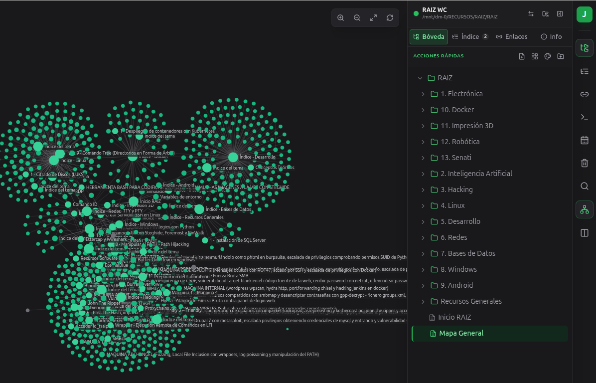
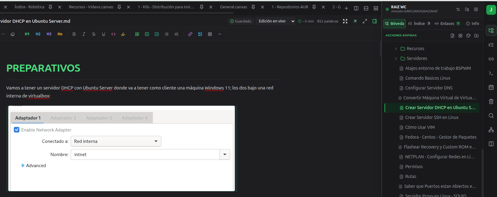
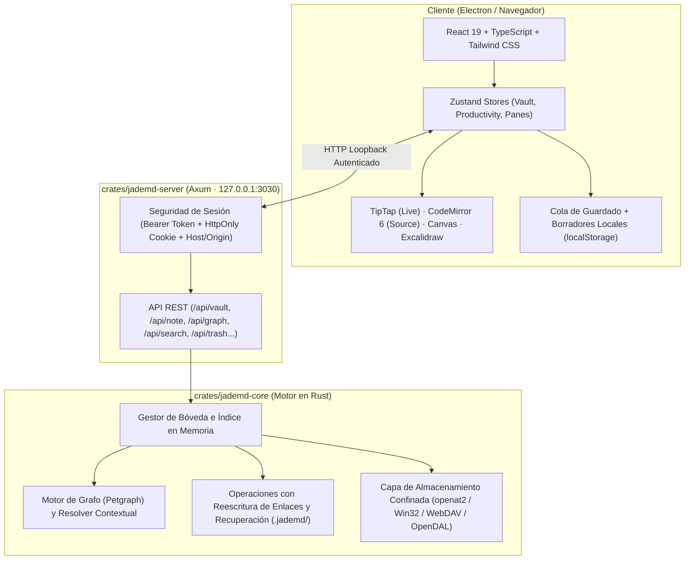

<div align="center">

# JadeMD

**Gestor de conocimiento personal basado en archivos Markdown, lienzos visuales y bases de datos locales.**
Diseñado en **Rust + React 19 + Electron** con enfoque en integridad de datos, preservación estricta de documentos y almacenamiento flexible.

[](Cargo.toml)
[](frontend/package.json)
[](frontend/tsconfig.json)
[](desktop/package.json)
[](.github/workflows/ci.yml)
[](LICENSE)

[Características](#-características-principales) · [Capturas](#-vista-general) · [Arquitectura](#-arquitectura) · [Inicio rápido](#-inicio-rápido) · [Seguridad e integridad](#-integridad-y-seguridad-de-datos) · [Documentación](#-documentación-técnica) · [Autoría](#-autoría-y-licencia)

</div>

---

> **Estado del proyecto: Alfa en estabilización.**
> El objetivo de JadeMD es alcanzar paridad funcional en los flujos esenciales de gestión de conocimiento personal manteniendo los documentos 100 % portables. Consulta la [matriz de paridad](docs/PARIDAD_OBSIDIAN.md) y el [reporte de estado](REPORTE_ESTADO.md) para conocer en detalle qué capacidades están verificadas, cuáles son parciales y cuáles siguen pendientes. No se anuncia compatibilidad completa con Obsidian ni con su ecosistema de plugins.

---

## ✨ Vista general

| Grafo de conocimiento interactivo | Edición en vivo y espacio de trabajo multipanel |
|:---:|:---:|
|  |  |

---

## 🚀 Características principales

### 📝 Edición multiparadigma con preservación de fuente
- **Cuatro modos de trabajo sincronizados:** Edición en vivo enriquecida (**TipTap**), código fuente (**CodeMirror 6**), vista de **Lectura** sin escrituras accidentales y **Vista dividida** (fuente + lectura simultánea).
- **Guardado por bloques no destructivo:** Al editar en vivo, JadeMD conserva intactos los bytes de los bloques que no fueron tocados, respetando el formato original de tablas, listas, comentarios, BOM y saltos de línea `CRLF`/`LF`.
- **Bloques protegidos con acceso a fuente:** Cualquier estructura que el editor visual aún no pueda representar de forma editable se protege automáticamente contra modificaciones accidentales y ofrece edición directa de su bloque fuente.
- **Propiedades YAML tipadas:** Parser completo con edición dirigida por rangos sobre el encabezado YAML (conservando comentarios y formato original).
- **Matemáticas, diagramas y notas al pie:** Soporte nativo para ecuaciones **KaTeX** inline (`$...$`) y en bloque (`$$...$$`), diagramas **Mermaid** renderizados en SVG aislado y **notas al pie** numeradas con navegación de ida y vuelta.

### 🧠 Red de conocimiento, búsqueda y Bases (`.base`)
- **Grafo e índice por ruta canónica:** Resolución determinista de wikilinks (`[[Nota#Encabezado|Alias]]`), enlaces Markdown relativos, notas incrustadas (*embeds*) y activos multimedia sin fusionar erróneamente notas con el mismo título en distintas carpetas.
- **Panel de conexiones e inspector:** Backlinks actualizados en tiempo real tras ediciones o borrados, enlaces salientes resueltos/faltantes y detección de **menciones no enlazadas** (excluyendo bloques de código y comentarios).
- **Búsqueda estructurada:** Consultas combinables con operadores `tag:` (con jerarquía de subetiquetas), `path:`, `file:`, `content:`, filtros de propiedades tipadas (`[estado:activo]`, `[prioridad:1]`), frases exactas y exclusiones con `-`.
- **Bases de datos de notas (`.base`):** Creación y edición de vistas tabulares (`table`) y listas (`list`) definidas en YAML sobre las propiedades del índice, con soporte para filtros anidados (`and`, `or`, `not`), `file.hasTag()`, `file.inFolder()`, comparaciones, aritmética y fórmulas encadenadas (subconjunto del [formato de Bases](https://help.obsidian.md/bases/syntax)).

### 🎨 Lienzos visuales y archivos multimedia
- **JSON Canvas (`.canvas`):** Lienzo interactivo con tarjetas de texto Markdown, grupos, notas/imágenes vinculadas y enlaces web; inspector de dimensiones y colores, conexiones dirigidas con etiquetas y preservación estricta de campos JSON desconocidos.
- **Excalidraw (`.excalidraw` y `.excalidraw.md`):** Integración completa con soporte de compresión LZ-String, exportación a PNG, SVG, portapapeles y escena editable `.excalidraw`.
- **Visor multimedia integrado:** Visualización nativa de imágenes (con *lightbox* y pegado directo en el editor) y documentos **PDF**.

### ⚡ Productividad, espacio de trabajo y exportación
- **Espacio de trabajo flexible:** Hasta **4 paneles independientes** con divisiones anidadas (horizontales o verticales), tamaño ajustable, historial de navegación propio por panel (`Alt+←/→`), pestañas fijables/reordenables y hasta **20 espacios de trabajo guardados** por bóveda.
- **Productividad cotidiana:** **Notas diarias** (`Ctrl/⌘+Shift+D`) con creación exclusiva, **plantillas** con sustitución de variables (`{{date}}`, `{{time}}`, `{{title}}`), **marcadores** persistentes con remapeo automático al mover archivos, panel jerárquico de **etiquetas** y **paleta de comandos** (`Ctrl/⌘+Shift+P`) con atajos de teclado configurables.
- **Exportación y publicación estática:**
  - Descarga del archivo original, exportación a **HTML autónomo** (con imágenes locales incrustadas, fórmulas en MathML y diagramas en SVG) y diálogo de **Impresión / PDF**.
  - **Exportar sitio estático:** Genera un archivo `index.html` autocontenido con hasta 50 notas seleccionadas, índice navegable, enlaces internos funcionales y adjuntos opcionales.

---

## 🏗️ Arquitectura



### Estructura del repositorio

```text
Jademd/
├── crates/
│   ├── jademd-core/       # Almacenamiento confinado, parser Markdown/YAML, grafo Petgraph, consultas y operaciones
│   └── jademd-server/     # Servidor HTTP Axum/Tokio en 127.0.0.1:3030, sesión segura y entrega de interfaz
├── frontend/              # Interfaz React 19, TypeScript, Zustand, TipTap, CodeMirror 6, Canvas, Excalidraw y Bases
├── desktop/               # Lanzador y proceso principal Electron con ciclo de vida acoplado al backend
├── scripts/               # Empaquetadores de escritorio (.deb, .AppImage, NSIS .exe) y pruebas de humo
├── tests/fixtures/        # Muestras compartidas (Rust/TS) de compatibilidad, BOM/CRLF, YAML y Canvas
└── docs/                  # Especificaciones de arquitectura, matriz de paridad y guías de verificación
```

---

## 🛠️ Requisitos

- **Sistema operativo:**
  - **Linux** con kernel `5.6+` (utiliza `openat2` para el confinamiento estricto de operaciones locales sin seguimiento de symlinks).
  - **Windows 10/11 x64** (compilación e instalador de escritorio verificados; pruebas automatizadas validadas principalmente en Linux). Requiere además **Visual Studio Build Tools** con la carga *Desarrollo para el escritorio con C++*. Consulta la **[guía de Windows](docs/WINDOWS.md)**.
- **Rust:** Toolchain `stable` instalado con [rustup](https://rustup.rs) (validado con Rust `1.99.1` en Linux y `1.100.0` en Windows, host `x86_64-pc-windows-msvc`).
- **Node.js:** `^22.12.0`, `^24.0.0` o `>=26.0.0` (el archivo `frontend/.nvmrc` selecciona Node `22`) y `npm`.

---

## ⚡ Inicio rápido

### 1. Ejecución directa como aplicación de escritorio (Recomendado)

```bash
./run.sh
```

Este script compila el binario Rust (`jademd`), instala las dependencias fijadas (`npm ci` cuando es necesario), construye la interfaz de producción y abre la ventana nativa de **Electron** sin instalar nada globalmente en el sistema:

- **Gestión de bóvedas:** Si no hay bóvedas registradas, se abre el selector para elegir una carpeta local, una carpeta compartida montada o una conexión remota. Con una única bóveda local se abre automáticamente; con varias se solicita elegir identificando la última utilizada.
- **Ciclo de vida seguro:** Al cerrar la ventana se vacían los guardados pendientes (si un guardado falla, la ventana permanece abierta para no perder datos). El proceso de Electron es dueño del backend mediante una tubería de control: al salir —incluso si el proceso gráfico termina abruptamente— el servidor Rust finaliza automáticamente.
- **Puerto local:** Por defecto escucha exclusivamente en `127.0.0.1:3030`. Puedes usar otro puerto definiendo `JADEMD_PORT=3100 ./run.sh`.

### 2. Modo de desarrollo en navegador (Opcional)

Si deseas trabajar con recarga en caliente (*Hot Module Replacement*) en el navegador:

```bash
# Terminal 1: Iniciar el servidor backend en 127.0.0.1:3030
cargo run --locked --bin jademd

# Terminal 2: Iniciar Vite en http://localhost:5173 (redirige /api a 3030)
cd frontend
npm ci
npm run dev
```

### 3. Generar instaladores de escritorio (`.deb`, `.AppImage`, `.exe`)

```bash
# Generar paquetes para Linux (.deb y .AppImage)
scripts/package-installers.sh linux

# Generar instalador NSIS (.exe) para Windows (desde Git Bash, requiere makensis)
scripts/package-installers.sh windows /ruta/al/backend/jademd.exe
```

En Windows, sin Bash ni NSIS instalados, desde PowerShell:

```powershell
cargo build --locked --release --bin jademd
npm.cmd --prefix frontend ci; npm.cmd --prefix frontend run build
npm.cmd --prefix desktop ci
cd desktop; npx.cmd electron-builder --win nsis --x64 --config.win.signAndEditExecutable=false
```

Los artefactos se generan en `target/desktop-installers/` e integran Electron, el binario de Rust compilado en modo `release` y la interfaz estática. La guía completa de requisitos, pruebas y solución de problemas en Windows está en **[docs/WINDOWS.md](docs/WINDOWS.md)**.

---

## 🔒 Integridad y seguridad de datos

JadeMD prioriza que **ninguna operación de lectura, fallo de red o conflicto externo corrompa tus notas**:

1. **Confinamiento y rutas seguras:** Todas las rutas dentro de una bóveda son relativas. Se rechazan secuencias de escape (`..`) y enlaces simbólicos tanto en lectura/escritura como durante la indexación.
2. **Escrituras condicionadas y detección de conflictos (`409` / `428`):**
   - `POST /api/note` exige `check_version: true` y `expected_content` (la revisión base leída o `null` si el archivo debe ser nuevo).
   - Las bóvedas locales comprueban cambios externos cada **5 segundos** y al recuperar el foco; las escrituras coordinan el reemplazo atómico con `.jademd-write.lock`.
   - Si otro editor modificó la nota mientras tenías un borrador local, el autoguardado se pausa y se abre el asistente **Comparar versiones** (permitiendo combinar cambios, aceptar la versión externa o guardar una copia en una ruta nueva).
3. **Papelera y recuperación supervisada de movimientos:**
   - Eliminar desde la interfaz mueve los archivos a `.jademd/trash/<id>/`, permitiendo restaurarlos sin sobrescribir archivos recreados posteriormente.
   - Renombrar o mover archivos actualiza automáticamente los enlaces de la bóveda registrando antes un manifiesto en `.jademd/operations/<id>/manifest.json`. Si una operación queda interrumpida, la interfaz detecta el estado y ofrece **Restaurar estado anterior** de forma segura e idempotente.
4. **Almacenamiento remoto con control de versión:**
   - El conector **WebDAV** verifica la conexión antes de activar la bóveda, indexa subcarpetas recursivamente (hasta 25.000 entradas y 64 niveles), exige un `ETag` fuerte al leer y envía `If-Match` al guardar (o `If-None-Match: *` al crear). Las contraseñas no se persisten en disco.
5. **API local protegida:** El servidor valida `Origin`/`Host`, emite una sesión aleatoria por ejecución (`GET /api/session`) y sirve los adjuntos bajo una política `Content-Security-Policy` en *sandbox*. No expongas el puerto en una red pública sin un proxy autenticador.

---

## ✅ Verificación y pruebas automatizadas

El proyecto cuenta con **190 pruebas automatizadas** (47 en Rust + 143 en Vitest/JSDOM) y un pipeline en `.github/workflows/ci.yml`:

```bash
# 1. Formato, linter estricto y pruebas del backend/núcleo en Rust
cargo fmt --all -- --check
cargo clippy --workspace --all-targets --locked -- -D warnings
cargo test --workspace --locked

# 2. Pruebas unitarias/DOM, verificación de tipos y compilación del frontend
cd frontend
npm run test
npm run typecheck
npm run build

# 3. Prueba de humo aislada del cliente de escritorio Electron (requiere xvfb en Linux)
cd ..
python3 scripts/test-desktop.py
```

---

## 📚 Documentación técnica

- 📊 **[Reporte de Estado Actual](REPORTE_ESTADO.md):** Auditoría técnica completa, métricas de código, trazabilidad de correcciones y hoja de ruta.
- 🧭 **[Matriz de Paridad con Obsidian](docs/PARIDAD_OBSIDIAN.md):** Inventario detallado de contratos verificados (`V`), implementados (`I`), parciales (`P`) y pendientes (`N`).
- 🛡️ **[Lote 1 — Estabilización y Seguridad](docs/CAMBIOS_ESTABILIZACION.md):** Confinamiento `openat2`, sesión de API, cola de guardado y corrección de condiciones de carrera.
- 📄 **[Etapa 2 — Compatibilidad de Documentos](docs/COMPATIBILIDAD_DOCUMENTOS.md):** Guardado por bloques, preservación de YAML/BOM/CRLF, embeds y fixtures compartidos.
- 🗂️ **[Etapa 3 — Trabajo Cotidiano](docs/TRABAJO_COTIDIANO.md):** Paneles divididos, historial por panel, renombrado con actualización de enlaces y papelera.
- 🔄 **[Integridad, Conflictos y Búsqueda](docs/INTEGRIDAD_CONOCIMIENTO.md):** Detección de cambios externos, resolución de conflictos (`409`), recuperación de movimientos y sintaxis de búsqueda.
- ⚙️ **[Productividad y Atajos](docs/PRODUCTIVIDAD.md):** Notas diarias, plantillas, marcadores, jerarquía de etiquetas y gestor de atajos.
- 🧮 **[Edición Avanzada y Exportación](docs/EDICION_AVANZADA.md):** KaTeX, Mermaid, notas al pie, exportación HTML/PDF y mejoras en Canvas y Excalidraw.
- 🖥️ **[Arquitectura Desktop (Electron)](docs/DESKTOP.md):** Gestión del proceso backend por tubería, aislamiento IPC y empaquetado de instaladores.
- 🪟 **[Guía de Windows](docs/WINDOWS.md):** Requisitos (Build Tools, Rust MSVC, Node), compilación, pruebas, generación del instalador `.exe` y solución de problemas.

---

## 👤 Autoría y licencia

- **Autor principal:** **Walther Curo De La Cruz**
- **Licencia:** Distribuido bajo la licencia **[GNU General Public License v3.0 (GPL-3.0)](LICENSE)**.