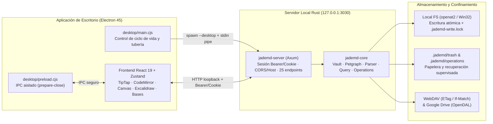

# Reporte de Estado del Proyecto — JadeMD

**Fecha de corte:** 6 de noviembre de 2026
**Versión actual:** `0.1.0` (Alfa en estabilización avanzada)
**Licencia:** GPL-3.0 (`LICENSE`)
**Referencias complementarias:** [Matriz de paridad con Obsidian](docs/PARIDAD_OBSIDIAN.md) · [Lote 1: Estabilización](docs/CAMBIOS_ESTABILIZACION.md) · [Etapa 2: Compatibilidad](docs/COMPATIBILIDAD_DOCUMENTOS.md) · [Etapa 3: Trabajo cotidiano](docs/TRABAJO_COTIDIANO.md) · [Integridad y conocimiento](docs/INTEGRIDAD_CONOCIMIENTO.md) · [Productividad](docs/PRODUCTIVIDAD.md) · [Edición avanzada](docs/EDICION_AVANZADA.md) · [Escritorio Electron](docs/DESKTOP.md)

---

## 1. Resumen ejecutivo y dictamen

**Dictamen actual:** JadeMD ha evolucionado desde un prototipo inicial con riesgos críticos de integridad (25 pruebas automatizadas el 5 de noviembre de 2026) hasta una **aplicación de escritorio y servidor local de gestión de conocimiento personal sólida, confinada y verificada por 190 pruebas automatizadas** (47 en Rust y 143 en Frontend/DOM), sin advertencias de Clippy (`-D warnings`), con tipado estricto en TypeScript y empaquetado de escritorio mediante Electron.

Todos los hallazgos bloqueantes (**P0** y **P1**) detectados en la auditoría inicial —escrituras accidentales al abrir Canvas, condiciones de carrera entre pestañas, pérdida de borradores al desmontar editores, silenciamiento de errores de guardado, colisiones de nodos homónimos en el grafo, ausencia de sesión en la API local, escape por enlaces simbólicos e inyección HTML— **han sido resueltos y cubiertos con pruebas de regresión**.

El proyecto se mantiene honestamente clasificado como **alfa en estabilización**: los flujos principales de edición, preservación por bloques, grafo, búsqueda estructurada, Bases (`.base`), Canvas, Excalidraw, productividad y escritorio Linux están operativos y probados, quedando pendientes la validación visual exhaustiva multiplataforma (Windows/móvil), el watcher incremental del sistema de archivos, la optimización de tamaño de bundles y un sistema de plugins.

---

## 2. Métricas del proyecto y validación ejecutada

### 2.1 Volumetría del código fuente

| Subsistema | Ruta principal | Archivos | Líneas de código (LOC) | Tecnologías clave |
|---|---|---:|---:|---|
| **Núcleo (`jademd-core`)** | `crates/jademd-core/src` | 15 | 3.558 | Rust 2021, Tokio, Petgraph, OpenDAL, Serde YAML/JSON, `rustix` (`openat2`) |
| **Tests del núcleo** | `crates/jademd-core/tests` | 6 | 657 | Pruebas de integración: compatibilidad, cambios externos, integridad, consultas, operaciones |
| **Servidor API (`jademd-server`)** | `crates/jademd-server/src` | 3 | 1.590 | Axum 0.7, Tower HTTP, autenticación Bearer + Cookie `HttpOnly`, explorador de carpetas |
| **Frontend (UI + Editores)** | `frontend/src` (sin tests) | 44 | 8.474 | React 19, TypeScript 5.7, Zustand 5, TipTap 3, CodeMirror 6, KaTeX, Mermaid 11, Excalidraw |
| **Tests del Frontend** | `frontend/src/test` | 18 | 1.819 | Vitest 5.1, JSDOM 28, pruebas reales de DOM, store y serialización |
| **Escritorio (`desktop`)** | `desktop/*.cjs` | 3 | 156 | Electron 45, ciclo de vida por tubería `stdin`, aislamiento de contexto y sandbox |
| **Total código y pruebas** | Workspace completo | **89** | **16.254** | + 8 documentos técnicos en `docs/` y scripts de empaquetado en `scripts/` |

### 2.2 Resultados de la suite de verificación (6 de noviembre de 2026)

| Comprobación | Comando ejecutado | Estado | Detalle |
|---|---|---|---|
| **Formato Rust** | `cargo fmt --all -- --check` | ✅ **Aprobado** | 0 diferencias de formato en todo el workspace |
| **Análisis estático Rust** | `cargo clippy --workspace --all-targets --locked -- -D warnings` | ✅ **Aprobado** | 0 advertencias ni errores en `jademd-core`, `jademd-server` y tests |
| **Pruebas Rust** | `cargo test --workspace --locked` | ✅ **47 / 47 aprobadas** | 15 unitarias (`core`) + 22 integración (`core/tests`) + 10 handlers HTTP (`server`) |
| **Pruebas Frontend** | `npm --prefix frontend run test` | ✅ **143 / 143 aprobadas** | 18 suites de Vitest ejecutadas en paralelo (~6,3 s) |
| **Tipado TypeScript** | `npm --prefix frontend run typecheck` | ✅ **Aprobado** | `tsc --noEmit` sin errores de tipos |
| **CI/CD** | `.github/workflows/ci.yml` | ✅ **Configurado** | Jobs automatizados para `rust` (fmt, clippy, test) y `frontend` (ci, test, build) |

---

## 3. Arquitectura y estado por subsistema

### 3.1 Núcleo y almacenamiento (`crates/jademd-core`)
- **Confinamiento del sistema de archivos (`local_fs.rs` / `local_fs_windows.rs`):** En Linux utiliza descriptores de directorio y `openat2` (`RESOLVE_BENEATH | RESOLVE_NO_SYMLINKS`) para impedir escapes mediante enlaces simbólicos o rutas `..`. Rechaza lecturas con secuencias UTF-8 inválidas para evitar corrupción silenciosa.
- **Escrituras atómicas y control de concurrencia:** Creación exclusiva de archivos (`create_new`), escritura mediante archivo temporal, `sync_data` y reemplazo atómico, coordinado mediante bloqueo `.jademd-write.lock` y control optimista de versiones (`check_version: true` + `expected_content`).
- **Operaciones de espacio de trabajo y recuperación (`operations.rs`):** Mover o renombrar notas/carpetas actualiza automáticamente wikilinks, enlaces Markdown relativos, embeds y referencias en nodos `.canvas`, registrando manifiestos de preparación en `.jademd/operations/<id>/manifest.json` con soporte de reversión automática o recuperación supervisada desde la UI.
- **Papelera local (`.jademd/trash`):** Eliminación segura con conservación de metadatos y restauración sin sobrescritura si el destino original fue recreado.
- **Grafo e indexación (`graph.rs`, `parser.rs`, `query.rs`, `knowledge.rs`):** Nodos identificados por ruta canónica normalizada (evitando colisiones por título), resolución contextual de rutas relativas, alias y encabezados, exclusión de bloques de código y comentarios HTML/Obsidian, motor de consultas combinadas (`tag:`, `path:`, `file:`, `content:`, `[propiedad:valor]`, exclusiones `-`) y detección de menciones no enlazadas.
- **Almacenamiento remoto (`remote_http.rs`, `webdav_write.rs`):** Recorrido recursivo de hasta 25.000 entradas y 64 niveles con tiempo límite de 90 s. Escrituras condicionadas en WebDAV exigiendo ETag fuerte (`If-Match` al actualizar, `If-None-Match: *` al crear).

### 3.2 Servidor HTTP y seguridad (`crates/jademd-server`)
- **Autenticación de sesión (`security.rs`):** Generación de token criptográfico aleatorio por proceso (`GET /api/session`), validado mediante cabecera `Authorization: Bearer <token>` o cookie `HttpOnly; SameSite=Strict` para recursos multimedia, además de verificación estricta de cabeceras `Origin` y `Host` (`127.0.0.1` / `localhost`).
- **Aislamiento de activos (`/api/asset`):** Sirve recursos binarios e imágenes con cabecera `Content-Security-Policy: default-src 'none'; img-src 'self' data: blob:; media-src 'self' data: blob:; style-src 'unsafe-inline'; sandbox`, neutralizando ejecución de scripts embebidos en archivos SVG o HTML.

### 3.3 Interfaz, edición y productividad (`frontend`)
- **Edición con preservación por bloques (`sourceDocument.ts`, `LiveView.tsx`, `CodeMirrorEditor.tsx`):** El editor en vivo (TipTap) segmenta el documento en bloques y conserva intactos los bytes de los bloques no modificados, así como BOM, saltos CRLF y comentarios del frontmatter YAML. Los bloques con sintaxis compleja no editable en vivo se muestran como bloques protegidos con acceso directo a fuente.
- **Modos de vista completos (`DocumentView.tsx`):** Modos `live` (edición enriquecida), `source` (CodeMirror 6), `reading` (solo lectura) y `split-preview` (fuente con vista previa simultánea), además de visor integrado de imágenes y documentos PDF.
- **Espacio de trabajo multipanel (`PaneContext.tsx`, `DocumentWorkspace.tsx`, `workspace.ts`):** Hasta 4 paneles con divisiones anidadas horizontales/verticales, redimensionamiento accesible, historial de navegación independiente por panel (`Alt+←/→`), pestañas fijables y reordenables, y hasta 20 diseños de espacio de trabajo guardados por bóveda.
- **Edición avanzada (`AdvancedNodes.ts`, `advancedRendering.ts`):** Soporte en vivo y lectura para fórmulas matemáticas KaTeX (`$...$` y `$$...$$` con `trust: false`), diagramas Mermaid 11 (`securityLevel: strict` en imagen SVG aislada) y notas al pie numeradas con navegación bidireccional.
- **Bases de datos de notas (`BaseView.tsx`, `baseDocument.ts`):** Soporte para archivos `.base` con vistas `table` y `list`, filtros booleanos anidados (`and`, `or`, `not`), funciones `file.hasTag()`, `file.inFolder()`, comparaciones y fórmulas encadenadas sobre las propiedades indexadas de la bóveda.
- **Canvas y Excalidraw (`CanvasView.tsx`, `ExcalidrawView.tsx`):** Soporte de JSON Canvas 1.0 (tarjetas de texto, grupos, archivos, enlaces web, colores, conexiones dirigidas con etiqueta y preservación de propiedades desconocidas) y dibujos `.excalidraw` / `.excalidraw.md` (compresión LZ-String compatible con Obsidian, exportación PNG/SVG/escena y detección de errores sin sobrescritura).
- **Productividad y publicación (`ProductivityPanel.tsx`, `ExportPanel.tsx`, `PublicationPanel.tsx`):** Notas diarias (`Ctrl/⌘+Shift+D`), plantillas con variables (`{{date}}`, `{{time}}`, `{{title}}`), marcadores con remapeo automático al renombrar, panel jerárquico de etiquetas, paleta de comandos (`Ctrl/⌘+Shift+P`) con atajos configurables y detección de colisiones, exportación individual (original, HTML autónomo con MathML/SVG/base64, impresión/PDF) y exportación de sitio estático (`index.html` autocontenido de hasta 50 notas con navegación interna).

### 3.4 Aplicación de escritorio (`desktop` y `scripts`)
- **Ejecución autocontenida (`desktop/main.cjs`):** Electron inicia su propio proceso `jademd --desktop`, espera la señal `JADEMD_READY` en loopback, coordina el vaciado de la cola de guardados antes de cerrar la ventana (`prepare-close` / `ready-to-close`) y garantiza el cierre del servidor mediante EOF en la tubería estándar incluso ante un fallo abrupto (`SIGKILL`) de la interfaz.
- **Empaquetado (`scripts/package-installers.sh`):** Generación automatizada en `target/desktop-installers` de paquetes `.deb` y `.AppImage` para Linux e instalador NSIS (`.exe`) para Windows.

---

## 4. Trazabilidad de hallazgos de la auditoría inicial (5 de noviembre → 6 de noviembre de 2026)

| ID | Severidad inicial | Hallazgo original (5-nov-2026) | Estado actual (6-nov-2026) | Evidencia y verificación |
|---|---|---|---|---|
| **A1** | **P0** | Abrir un `.canvas` podía sobrescribirlo con una plantilla vacía | ✅ **Resuelto** | Separación de estados `loading`/`ready`/`error`; `CanvasView` nunca escribe durante la apertura (`vaultStore.test.ts`, `canvasDocument.test.ts`). |
| **A2** | **P1** | Carrera al abrir nota A y luego B colocaba el contenido de A en B | ✅ **Resuelto** | Control de secuencia de apertura e identidad de bóveda tras cada `await` (`vaultStore.test.ts`). |
| **A3** | **P1** | Desmontar editores descartaba cambios pendientes del temporizador | ✅ **Resuelto** | Cola de guardado persistente por documento y borradores en `draftStorage.ts` que sobreviven al cierre de pestañas/paneles. |
| **A4** | **P1** | La interfaz mostraba «Guardado» aunque la petición HTTP fallara | ✅ **Resuelto** | Errores propagados al estado del documento, indicador de error con botón de reintento y retención de borrador. |
| **A5** | **P1** | Imposibilidad de guardar una nota completamente vacía | ✅ **Resuelto** | Store y endpoint `POST /api/note` aceptan `content: ""` (`integrity.rs`, `main.rs`). |
| **A6** | **P1** | Crear una nota podía sobrescribir un archivo existente | ✅ **Resuelto** | `POST /api/note/create` y `create_new` aplican creación exclusiva y devuelven HTTP `409 Conflict` ante colisión. |
| **B1/B2** | **P1** | Enlaces obsoletos tras editar/borrar y fusión de notas homónimas | ✅ **Resuelto** | Identidad de nodos por ruta normalizada; `insert_note` y `remove_note` reemplazan/limpian aristas (`integrity.rs`). |
| **B3** | **P2** | Reindexar conservaba en caché archivos eliminados externamente | ✅ **Resuelto** | Reconstrucción atómica de caché y grafo al reindexar y en el refresco periódico (`external_changes.rs`). |
| **B4** | **P2** | Sin detección de cambios externos y parser sensible a bloques de código | ✅ **Resuelto** | Refresco cada 5 s y al recuperar foco con resolución de conflictos (`409`); parser ignora código cercado/inline y comentarios. |
| **B5** | **P2** | Búsqueda susceptible a respuestas fuera de orden y sin filtros | ✅ **Resuelto** | Control de secuencia en búsquedas y motor de consultas estructuradas con límite determinista (`query.rs`). |
| **C1** | **P1** | API local con CORS abierto y sin autenticación de sesión | ✅ **Resuelto** | Middleware `security::authorize` con token Bearer, cookie `HttpOnly`, validación de `Origin` y `Host` (`security.rs`). |
| **C2** | **P1** | Lectura/escritura fuera de la bóveda mediante enlaces simbólicos | ✅ **Resuelto** | Confinamiento con `openat2` (`RESOLVE_BENEATH \| RESOLVE_NO_SYMLINKS`) en Linux y rechazo explícito de symlinks (`local_fs.rs`). |
| **C3** | **P1** | Inserción `innerHTML` sin escape en fallback de imagen de CodeMirror | ✅ **Resuelto** | Construcción segura con nodos DOM (`textContent`) y CSP estricta en `/api/asset`. |
| **D1** | **P1** | Bóvedas remotas sin indexación recursiva ni escrituras condicionadas | ✅ **Resuelto** | Indexación recursiva remota con límites seguros y escritura WebDAV condicionada por ETag fuerte (`webdav_write.rs`). |
| **D2** | **P2** | Arranque acoplado a una ruta local personal fija | ✅ **Resuelto** | Eliminada ruta cableada; gestor de bóvedas persistido por perfil con soporte de argumento CLI (`vaultStartup.test.ts`). |
| **D3–D5** | **P2** | Exclusión de `.excalidraw`, falta de visor PDF y modos incompletos | ✅ **Resuelto** | Visor PDF integrado, `.excalidraw` visible en árbol, 4 modos de edición operativos y preservación estricta de escenas. |

---

## 5. Estado del repositorio Git y puntos de atención antes de publicar en GitHub

### 5.1 Árbol de trabajo en Git
- Actualmente el repositorio tiene un historial de **8 commits** en la rama `master` (último commit `4ee5f30`), y todo el trabajo de estabilización, nuevas capacidades, pruebas, documentación y aplicación de escritorio se encuentra en el árbol de trabajo local (**32 archivos modificados/eliminados** de `demo_vault` y **múltiples archivos nuevos sin seguimiento** en `crates/`, `frontend/`, `desktop/`, `docs/`, `scripts/`, `tests/`, `.github/`, `LICENSE`, `Cargo.lock`, `Jademd_1.png`, `Jademd_2.png`).
- **Acción recomendada antes de hacer `git push`:** Revisar `git status`, añadir los archivos del proyecto (`git add .`) y realizar un commit limpio (o una serie de commits atómicos por área) para que el repositorio remoto en GitHub incluya `Cargo.lock`, `.github/workflows/ci.yml`, `LICENSE`, `docs/` y todas las mejoras verificadas.

### 5.2 Límites técnicos conocidos y hoja de ruta (Backlog)
1. **Tamaño de bundles del frontend:** El empaquetado de producción con Vite genera chunks grandes para librerías gráficas y de diagramación (`Excalidraw`, `Mermaid`, `KaTeX`). Aunque se cargan bajo demanda en las vistas correspondientes, conviene seguir optimizando la partición de chunks (`manualChunks`).
2. **Vigilancia de archivos a gran escala:** La detección de cambios externos en bóvedas locales utiliza un sondeo de huella cada 5 segundos y al recuperar el foco; para bóvedas de decenas de miles de notas, el siguiente paso es integrar un watcher incremental basado en eventos del sistema operativo (`notify`).
3. **Validación en entornos reales externos:**
   - **Windows:** Existe implementación de sistema de archivos local (`local_fs_windows.rs`) y script de empaquetado NSIS (`scripts/jademd-installer.nsi`), pero la validación automatizada actual se ha ejecutado en Linux.
   - **WebDAV / SMB:** Las pruebas unitarias verifican el protocolo de cabeceras (`ETag`, `If-Match`, `If-None-Match`) y bloqueos locales, quedando pendiente una batería E2E contra instancias reales de Nextcloud y recursos Samba multi-cliente.
   - **Google Drive:** El conector básico OpenDAL se mantiene sin garantías atómicas CAS; está marcado fuera del alcance prioritario actual en la matriz de paridad.
4. **Capacidades futuras de la hoja de ruta (`docs/PARIDAD_OBSIDIAN.md`):**
   - Historial de versiones de archivos en disco independiente de los borradores del navegador.
   - Comandos con `/` dentro del editor, inserción de plantillas en la posición del cursor y notas al pie inline (`^[texto]`).
   - Agrupación y resúmenes estadísticos en vistas `.base`.
   - Diseño de una API propia de extensiones/plugins con aislamiento de permisos.
